#  Backtracking

<p align="center">
  <a href="https://backtracking.kamelkyp.com/">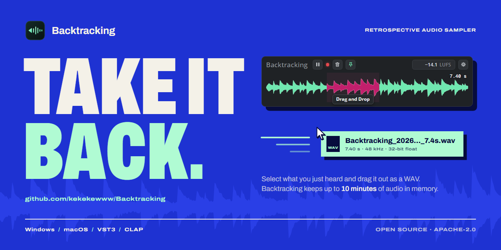</a>
</p>

<p align="center">
  <a href="https://github.com/kekekewww/Backtracking/releases/latest"></a>
  <a href="https://github.com/kekekewww/Backtracking/releases"></a>
  <a href="LICENSE"></a>
  
</p>

<p align="center">
  <b><a href="https://backtracking.kamelkyp.com/">Website</a></b> ·
  <b><a href="https://backtracking.kamelkyp.com/#demo">Live demo</a></b> ·
  <b><a href="https://github.com/kekekewww/Backtracking/releases/latest">Download</a></b> ·
  <b><a href="docs/USER_GUIDE.md#english">User guide</a></b> ·
  <b><a href="https://buymeacoffee.com/kamelkyp/e/596694">Support the developer</a></b>
</p>

<p align="center">English · <a href="README.zh-TW.md">繁體中文</a></p>

**It was already listening.** Backtracking is a retrospective audio sampler for music production and mixing. It keeps the last 10 seconds to 10 minutes of audio in memory. When you hear something worth keeping, select it on the waveform and drag it out as a WAV, straight onto a DAW track or into a folder.

<p align="center">
  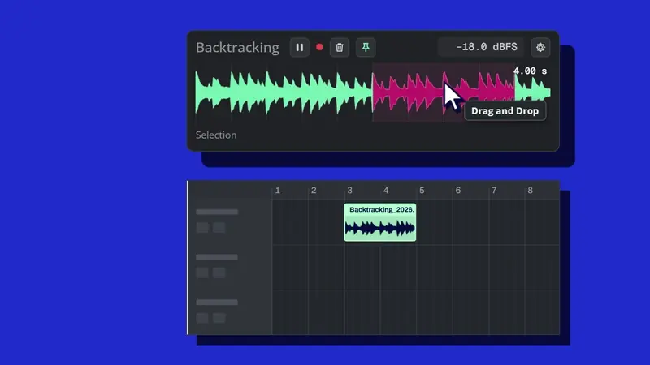
</p>

## How it works

1. **It's already listening.** Backtracking keeps the last 10 seconds to 10 minutes of audio in memory.
2. **Select the part you want.** Drag across the waveform. Hold `Shift` to snap to flags, bars or seconds.
3. **Drag it out as a WAV.** Drop it on a DAW track or into a folder. Recording keeps running in the background.

You can try this in a browser, with nothing to install: [open the live demo](https://backtracking.kamelkyp.com/#demo).

## Editions

<p align="center">
  <a href="marketing/posters/out/Backtracking-edition-windows-en.png">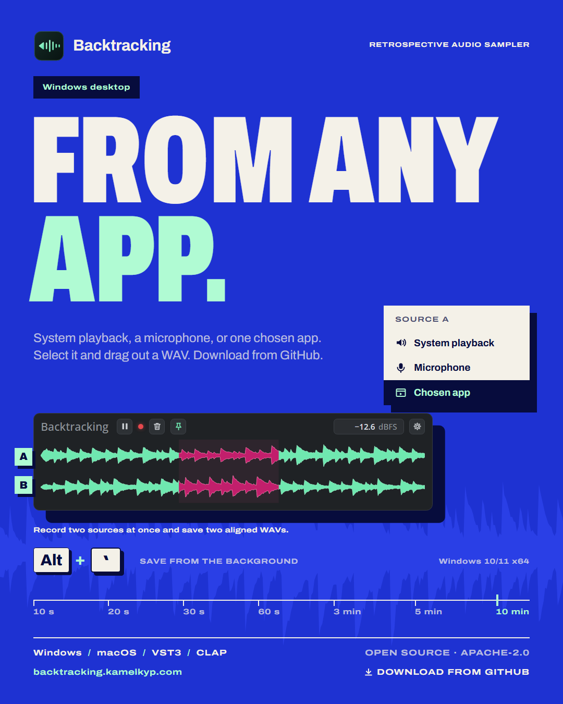</a>
  <a href="marketing/posters/out/Backtracking-edition-macos-en.png">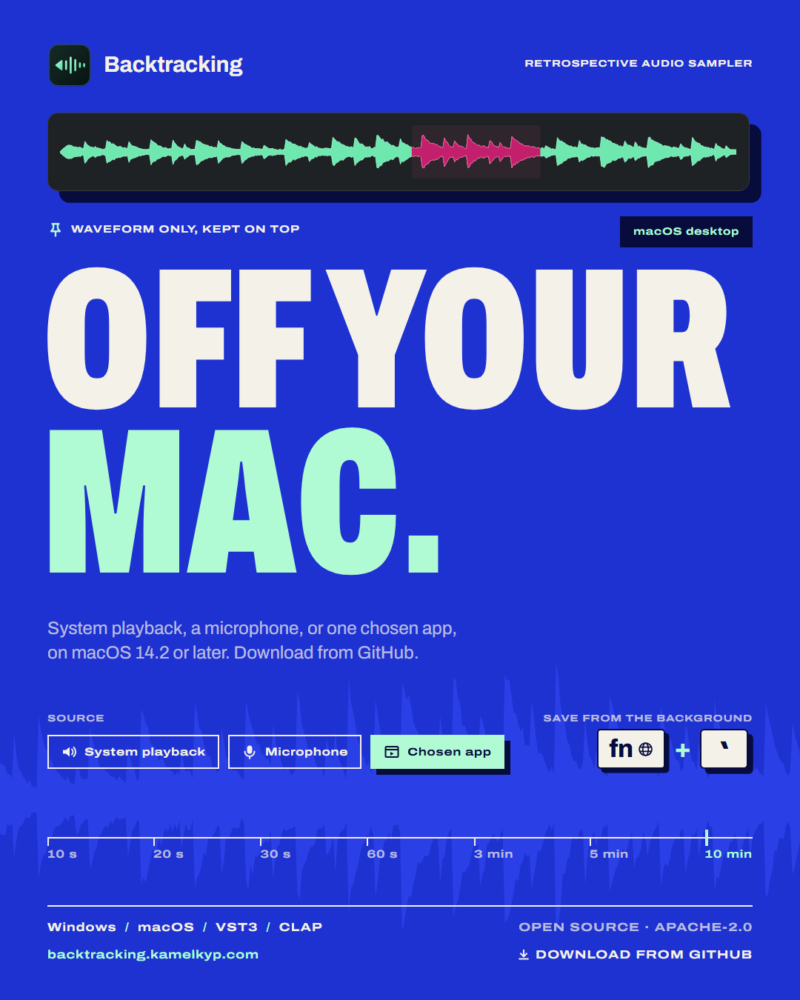</a>
  <a href="marketing/posters/out/Backtracking-edition-plugin-en.png">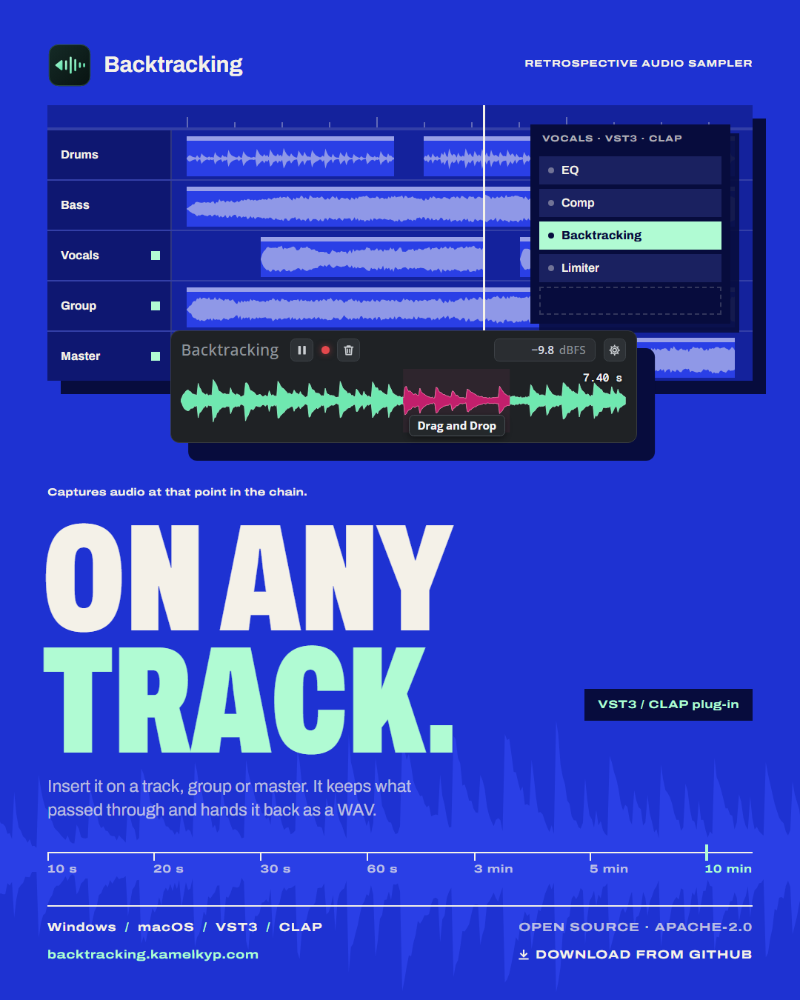</a>
  <a href="marketing/posters/out/Backtracking-edition-linux-en.png">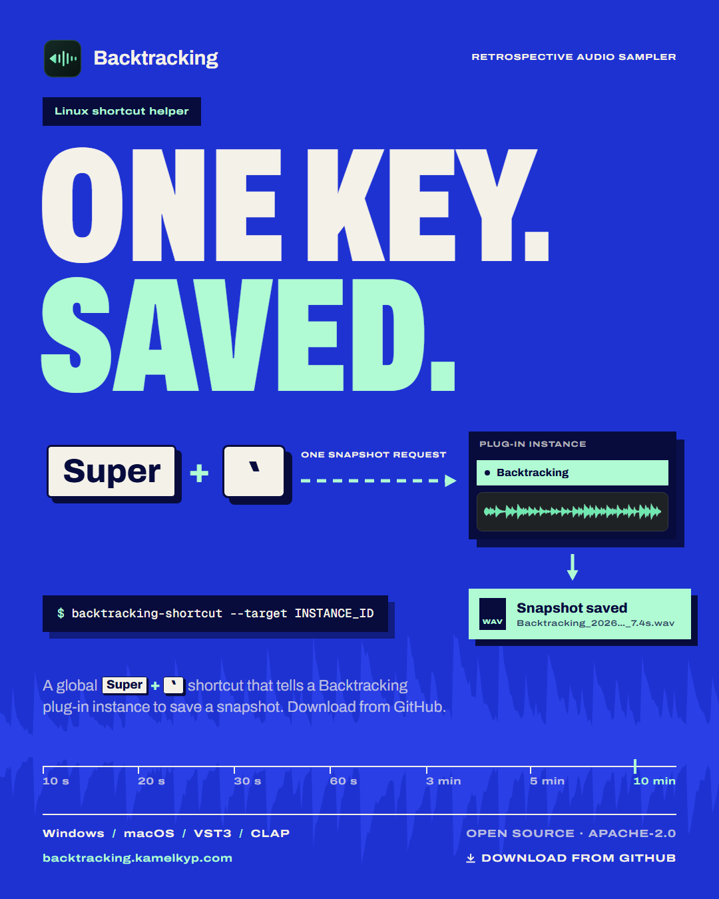</a>
</p>

| Edition | What it captures | Requirements |
| --- | --- | --- |
| **Windows desktop** | System playback, a microphone or one chosen app, on up to two tracks (A/B) | Windows 10 or 11, x64. Capturing one chosen app needs Windows 11. |
| **macOS desktop** | System playback, a microphone or one chosen app, on up to two tracks (A/B) | macOS 14.2 or later, Apple silicon |
| **VST3 / CLAP plug-in** | The audio passing its insert point on a track, group or master, or its sidechain input | A VST3 or CLAP host on Windows x64 or Apple silicon macOS |
| **Linux shortcut helper** | Nothing itself. A global `Super` + `` ` `` shortcut tells a Backtracking plug-in instance to save a snapshot. | X11 or Wayland. See the [helper's notes](desktop/linux/README.md). |

## Features

<table>
  <tr>
    <td width="50%" valign="top">
      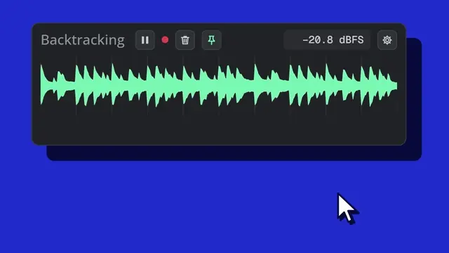<br>
      <b>Select with snapping.</b> Hold <code>Shift</code> while you drag and the selection snaps to flags, then bar lines, then seconds lines. <code>Esc</code> cancels it.
    </td>
    <td width="50%" valign="top">
      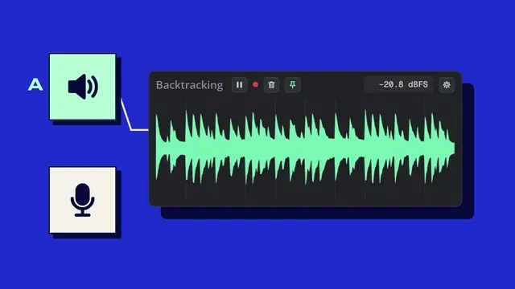<br>
      <b>Two sources at once.</b> The desktop apps record an A and a B source side by side and save two WAVs with aligned boundaries.
    </td>
  </tr>
  <tr>
    <td width="50%" valign="top">
      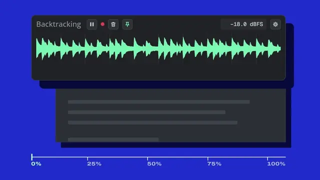<br>
      <b>Waveform only.</b> Shrink the window to a thin strip, keep it on top and set how transparent its background is.
    </td>
    <td width="50%" valign="top">
      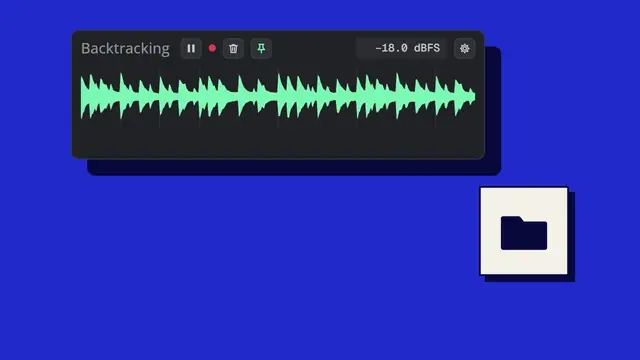<br>
      <b>Snapshot from anywhere.</b> <code>Alt</code> + <code>`</code> on Windows, or <code>Fn</code>/Globe + <code>`</code> on macOS, saves a WAV while Backtracking stays in the background.
    </td>
  </tr>
</table>

- **History you choose.** 10, 20, 30 or 60 seconds, or 3, 5 or 10 minutes. Long silence is left out by default; **Keep quiet sections** keeps it.
- **Editing never stops the recording.** Selecting, moving flags, zooming and panning work on a fixed copy of the audio while capture continues in the background.
- **One lane at a time.** With two sources, tap the right `Ctrl` key (right `Command` on a Mac) to select, preview, fade and drag out A or B on its own.
- **Files named after their source.** Desktop WAVs are named like `Backtracking_Spotify_A_…`. Give each device its own name in **Options → Sources**, and the name follows it to either lane.
- **Up to 64 sources.** In the Windows desktop app, **Add source** in **Options → Sources** records more sources at once, up to 64 lanes and 64 channels in all. Their history shares one memory budget, so it gets shorter as channels are added, and each file carries its lane's letter. The macOS app and the plug-ins are unchanged.
- **Plug-in to desktop.** Tick **Send to Backtracking desktop** in a plug-in instance and the desktop app lists that track as a source.
- **More than one recorder.** **New capture window** opens extra desktop recorders, each with its own source.
- **AI agents.** In the Windows desktop app, the [Backtracking Agent](addons/backtracking-agent/README.md) add-on lets Claude Code, Claude Desktop or another MCP client pause and start recording, select, save files and change sources, once you allow it on the **Add-ons** page.
- **WAV the way you need it.** 44.1, 48 or 96 kHz, in 16-bit PCM, 24-bit PCM or 32-bit float. The default is 48 kHz, 32-bit float.
- **Readable levels.** The live meter shows dBFS, VU or momentary LUFS, and the waveform can be merged or split into L/R.
- **Color by frequency.** In the Windows desktop app, **Waveform color: By frequency** colors the waveform from its low to its high frequencies, red to blue by default, in colors you can change.
- **Your look.** Accent color, border width, background transparency, and whether the app name, meters and capture status mark are shown.
- **A tidy disk.** A snapshot is saved to one folder only. **Delete old drag-and-drop files**, Off by default, removes drag-and-drop WAVs after 10, 20, 30, 60 or 90 days.
- **Signed updates.** The desktop apps can install later releases from **Options → Updates**.

## Download and install

**[Download the latest release from GitHub](https://github.com/kekekewww/Backtracking/releases/latest)**

**Windows 10 or 11, x64**

1. Quit any earlier Backtracking from the system tray, and close your DAW.
2. Run `Backtracking-…-Windows-x64-Setup.exe`. Choose the desktop app, VST3 and CLAP separately, and a folder for each.
3. Add the plug-in folders you chose to your DAW's scan paths.

Setup installs for the current user, and uninstalling keeps your recordings and settings.

**macOS 14.2 or later, Apple silicon**

1. Open `Backtracking-…-macOS-arm64.dmg` and drag Backtracking to Applications.
2. The build is not notarized by Apple, so macOS blocks the first launch. Open **System Settings → Privacy & Security** and choose **Open Anyway**, then allow system audio recording when asked.
3. Plug-ins: close your DAW, then copy `Backtracking.vst3` and `Backtracking.clap` from the `Plug-ins` folder to `~/Library/Audio/Plug-Ins/VST3/` and `~/Library/Audio/Plug-Ins/CLAP/`.

**Linux**

Build the shortcut helper with the steps in [desktop/linux/README.md](desktop/linux/README.md).

Each release lists what changed and the SHA-256 of its files: [all releases](https://github.com/kekekewww/Backtracking/releases). How the desktop apps update themselves is described in [docs/UPDATES.md](docs/UPDATES.md). The plug-ins do not update automatically.

## Quick start

1. Open the desktop app, or insert **Backtracking** in a DAW track's effects chain.
2. Play audio. The red light blinks while audio is being recorded, and the newest audio enters the waveform from the right.
3. Drag the waveform out of the window onto a DAW track or a folder to export everything it holds. For a shorter clip, select first: `Ctrl`-drag on Windows or `Option`-drag on macOS for a free selection, `Shift`-drag for a snapped one. Then drag the highlighted range out.
4. Press `Esc` to drop the selection and return to the live view.

On the desktop, right-click the window for the menu, or click the gear for **Options**. With the window focused, `Space` pauses or resumes capture and `Delete` (`Fn` + `Delete` on a Mac keyboard) clears the current recording. With a selection, `Space` plays the selection and `Alt`-dragging (`Option` on a Mac) a selection flag fades it in or out. With two sources, a tap of the right `Ctrl` key (right `Command` on a Mac) lets you edit A and B separately. On Windows these keys and the global snapshot shortcut are defaults; change them in Options → **Hotkeys**. A few key combinations cannot be used because Windows or the window itself uses them.

## Watch

<p align="center">
  <a href="https://backtracking.kamelkyp.com/media/overview-en.mp4">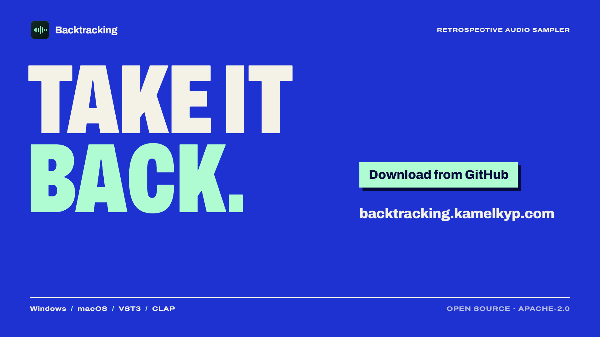</a>
</p>

<p align="center">
  <a href="https://backtracking.kamelkyp.com/media/overview-en.mp4">Overview video</a> ·
  <a href="https://backtracking.kamelkyp.com/media/short-en.mp4">Short, 9:16</a> ·
  <a href="https://backtracking.kamelkyp.com/#demo">Live demo in the browser</a>
</p>

## Documentation

| For | Read |
| --- | --- |
| Using Backtracking | [User guide](docs/USER_GUIDE.md#english) · [Sources, waveforms and flags](docs/USER_GUIDE.md#sources-waveforms-and-flags) · [Troubleshooting](docs/USER_GUIDE.md#troubleshooting) |
| Installing and building | [Installation and build](docs/USER_GUIDE.md#安裝與建置--installation-and-build) · [Windows Setup](desktop/windows/installer/README.md) · [Linux shortcut helper](desktop/linux/README.md) |
| Updates | [How updates are signed and installed](docs/UPDATES.md) |
| Measurements | [Hardware usage](docs/HARDWARE_USAGE.md) |
| Engineering notes | [Responsive editing](docs/RESPONSIVE_EDITING_2026-11-14.md) · [Quiet capture and waveform](docs/QUIET_CAPTURE_AND_WAVEFORM_2026-11-14.md) · [Waveform display research](docs/WAVEFORM_DISPLAY_RESEARCH_2026-11-14.md) |
| Posters, videos and the website | [Campaign guide](marketing/brand/README.md) · [Posters](marketing/posters/README.md) · [Videos](marketing/video/README.md) · [Landing page](marketing/site/README.md) |

The history lives in memory, so a longer history uses more of it. In the measurement of 14 November 2026, the Windows desktop app used about 400 MiB with a full 10-minute history and about 190 MiB at 30 seconds. The [hardware usage page](docs/HARDWARE_USAGE.md) has the conditions and the full data.

## Build from source

Use Rust 1.95 or a newer stable version. The build commands for each edition are in [Installation and build](docs/USER_GUIDE.md#安裝與建置--installation-and-build).

```sh
git clone https://github.com/kekekewww/Backtracking.git
cd Backtracking
cargo fmt --all -- --check
cargo test --workspace --locked
cargo clippy --workspace --all-targets --locked -- -D warnings
```

## Support

Backtracking is open source. If it saves you a take, you can [support the developer on Buy Me a Coffee](https://buymeacoffee.com/kamelkyp/e/596694). Found a problem or have an idea? [Open an issue](https://github.com/kekekewww/Backtracking/issues).

## License

Original Backtracking work in this repository is licensed under the Apache License 2.0. Third-party dependencies and assets retain their respective licenses. [Full license](LICENSE) · [Open Sans font license](crates/backtracking-core/assets/OpenSans-LICENSE.txt) · [Campaign fonts](marketing/fonts/FONTS.txt)
