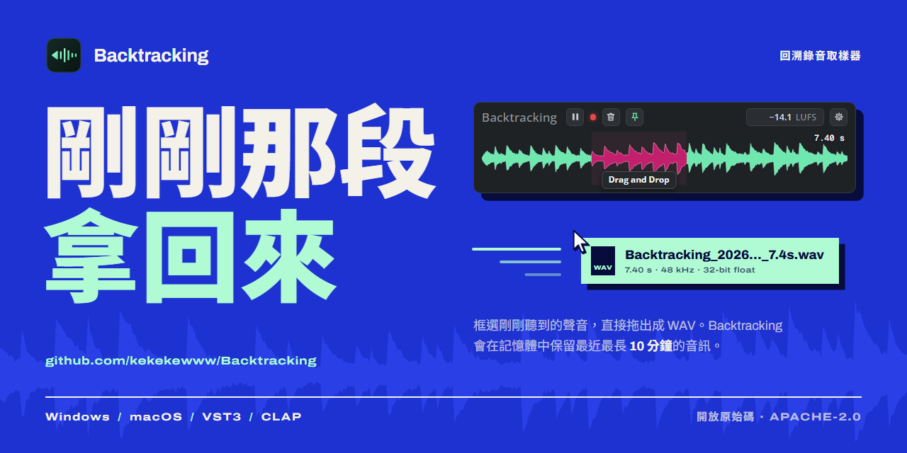
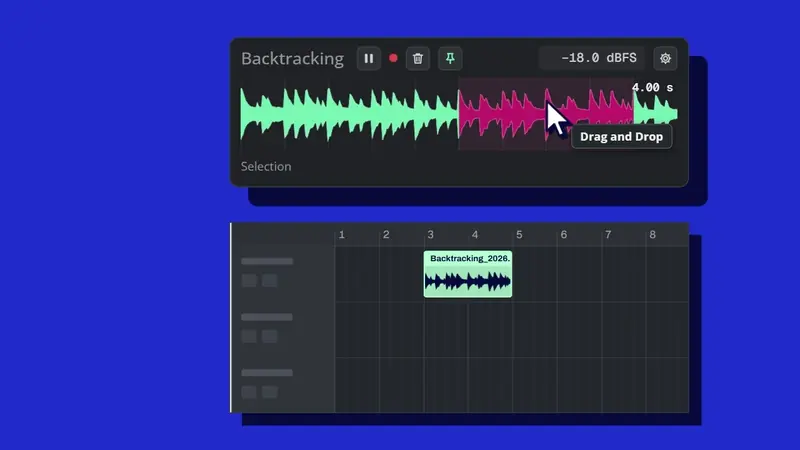
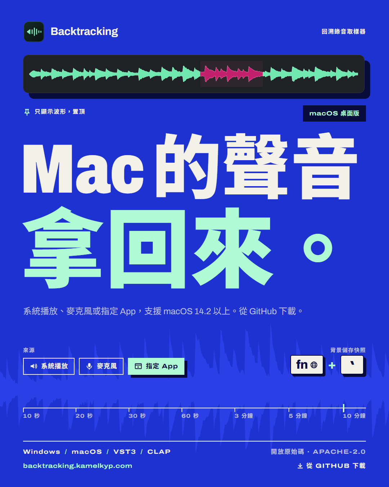
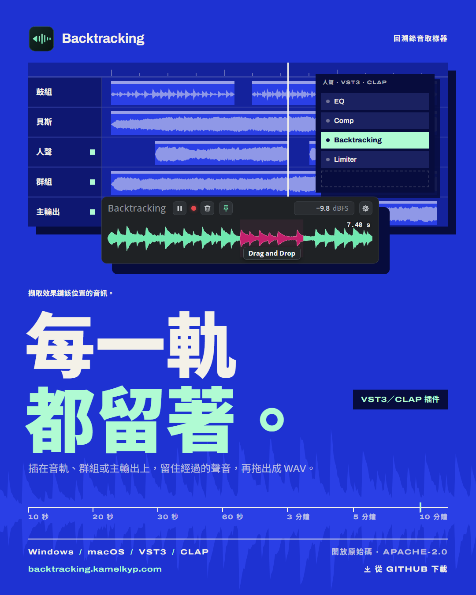
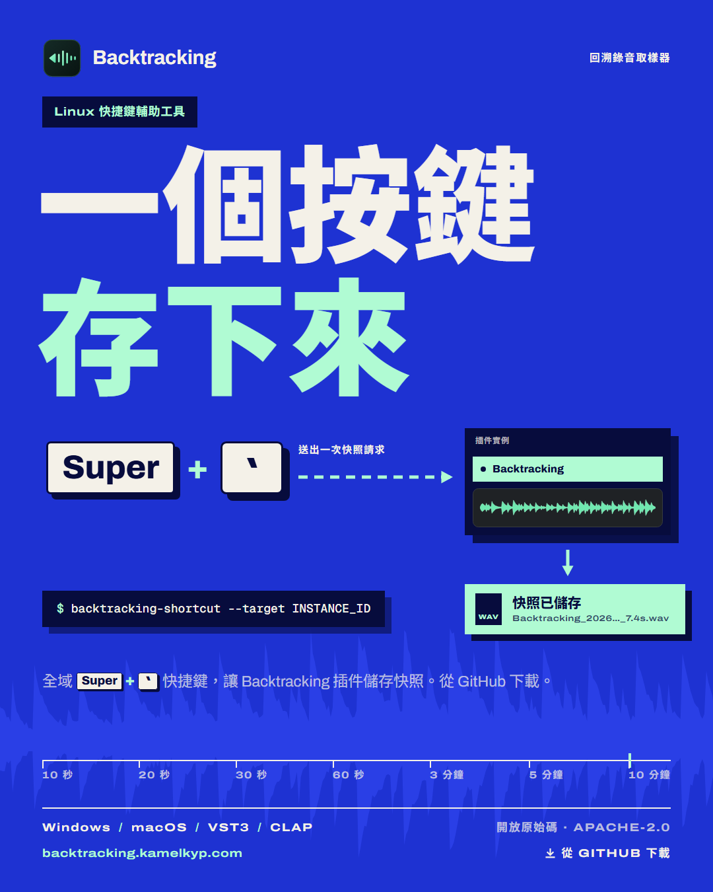
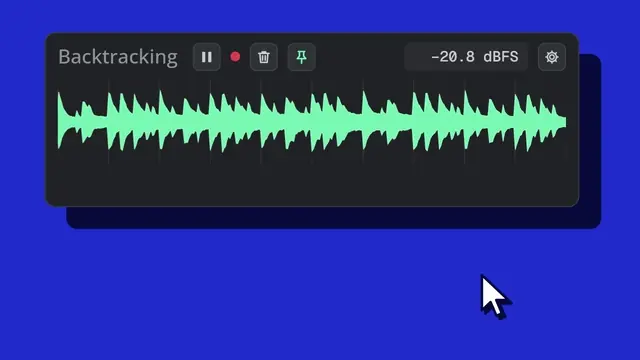
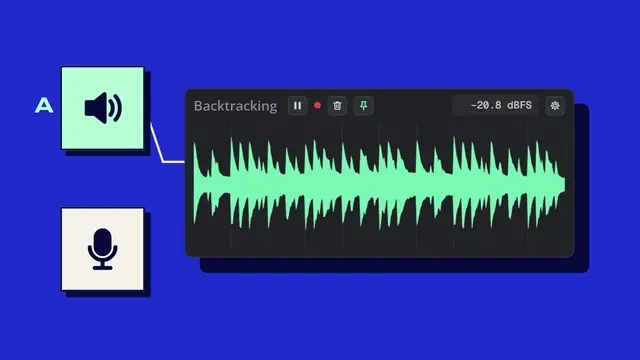
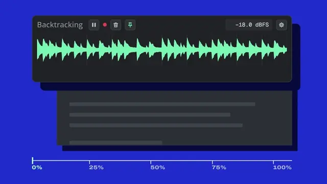
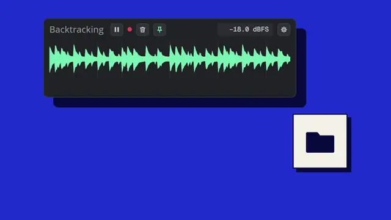
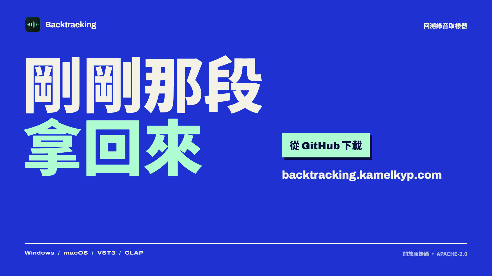

#  Backtracking

<p align="center">
  <a href="https://backtracking.kamelkyp.com/zh-tw/"></a>
</p>

<p align="center">
  <a href="https://github.com/kekekewww/Backtracking/releases/latest"></a>
  <a href="https://github.com/kekekewww/Backtracking/releases"></a>
  <a href="LICENSE"></a>
  
</p>

<p align="center">
  <b><a href="https://backtracking.kamelkyp.com/zh-tw/">官方網站</a></b> ·
  <b><a href="https://backtracking.kamelkyp.com/zh-tw/#demo">線上試用</a></b> ·
  <b><a href="https://github.com/kekekewww/Backtracking/releases/latest">下載</a></b> ·
  <b><a href="docs/USER_GUIDE.md#繁體中文">使用手冊</a></b> ·
  <b><a href="https://buymeacoffee.com/kamelkyp/e/596694">贊助開發者</a></b>
</p>

<p align="center"><a href="README.md">English</a> · 繁體中文</p>

**它一直都在聽** Backtracking 是給作曲與混音用的回溯錄音取樣器，會在記憶體中保留最近 10 秒到 10 分鐘的音訊。聽到想留下的聲音時，在波形上框選，直接拖出成 WAV，放到 DAW 音軌或資料夾。

<p align="center">
  
</p>

## 運作方式

1. **它一直都在聽** Backtracking 在記憶體中保留最近 10 秒到 10 分鐘的音訊。
2. **框選想要的那一段** 在波形上拖曳框選，按住 `Shift` 可吸附旗標、小節線或秒數線。
3. **直接拖出成 WAV** 放到 DAW 音軌或資料夾，背景會繼續錄音。

不必安裝，也可以先在瀏覽器裡試：[開啟線上試用](https://backtracking.kamelkyp.com/zh-tw/#demo)。

## 版本

<p align="center">
  <a href="marketing/posters/out/Backtracking-edition-windows-zh-TW.png"></a>
  <a href="marketing/posters/out/Backtracking-edition-macos-zh-TW.png"></a>
  <a href="marketing/posters/out/Backtracking-edition-plugin-zh-TW.png"></a>
  <a href="marketing/posters/out/Backtracking-edition-linux-zh-TW.png"></a>
</p>

| 版本 | 擷取來源 | 系統需求 |
| --- | --- | --- |
| **Windows 桌面版** | 系統播放、麥克風或指定 App，可同時擷取 A／B 兩路 | Windows 10／11 x64。擷取指定 App 需 Windows 11。 |
| **macOS 桌面版** | 系統播放、麥克風或指定 App，可同時擷取 A／B 兩路 | macOS 14.2 以上，Apple silicon |
| **VST3／CLAP 插件** | 音軌、群組或主輸出效果鏈上，經過插件位置的音訊，也可改擷取 Sidechain 輸入 | Windows x64 或 Apple silicon macOS 上支援 VST3 或 CLAP 的 DAW |
| **Linux 快捷鍵輔助工具** | 本身不錄音。全域 `Super` + `` ` `` 快捷鍵，讓 Backtracking 插件儲存快照。 | X11 或 Wayland，見[輔助工具說明](desktop/linux/README.md)。 |

## 功能

<table>
  <tr>
    <td width="50%" valign="top">
      <br>
      <b>吸附框選</b><br>按住 <code>Shift</code> 拖曳，選區依序吸附旗標、小節線、秒數線。按 <code>Esc</code> 取消。
    </td>
    <td width="50%" valign="top">
      <br>
      <b>同時擷取兩個來源</b><br>桌面版可同時擷取 A／B 兩路，匯出兩個起訖對齊的 WAV。
    </td>
  </tr>
  <tr>
    <td width="50%" valign="top">
      <br>
      <b>只顯示波形</b><br>把視窗縮成細條並置頂，背景透明度可自行調整。
    </td>
    <td width="50%" valign="top">
      <br>
      <b>隨時儲存快照</b><br>Windows 按 <code>Alt</code> + <code>`</code>，macOS 按 <code>Fn</code>／Globe + <code>`</code>，Backtracking 在背景就能存成 WAV。
    </td>
  </tr>
</table>

- **保留時間自己選** 10、20、30、60 秒或 3、5、10 分鐘。預設略過長靜音，開啟 **Keep quiet sections** 可保留安靜片段。
- **編輯時照常錄音** 框選、調整旗標、縮放與平移使用固定的素材，背景繼續擷取。
- **單獨編輯一軌** 擷取兩個來源時，輕按右側 `Ctrl`（Mac 為右側 `Command`），即可單獨框選、試聽、淡化與拖出 A 或 B。
- **檔名標示來源** 桌面版的 WAV 以來源命名，例如 `Backtracking_Spotify_A_…`。可在 **Options → Sources** 為每個裝置取名，名稱跟著裝置換到 A 或 B。
- **插件送到桌面版** 在插件勾選 **Send to Backtracking desktop**，桌面版的來源清單就會列出該音軌。
- **多個錄音器** 桌面版可用 **New capture window** 開啟額外的擷取視窗，各自選擇來源。
- **WAV 規格** 44.1、48 或 96 kHz，16-bit PCM、24-bit PCM 或 32-bit float。預設為 48 kHz、32-bit float。
- **音量一目了然** 即時音量表可顯示 dBFS、VU 或瞬時 LUFS，波形可合併顯示或分成 L/R。
- **外觀可調** 主題色、外框寬度、背景透明度，以及是否顯示程式名稱、音量表與擷取狀態標記。
- **不佔多餘空間** 快照只存到一個資料夾。**Delete old drag-and-drop files** 預設關閉，開啟後會刪除超過 10、20、30、60 或 90 天的拖放 WAV。
- **簽章更新** 桌面版可在 **Options → Updates** 安裝之後的版本。

## 下載與安裝

**[從 GitHub 下載最新版本](https://github.com/kekekewww/Backtracking/releases/latest)**

**Windows 10／11 x64**

1. 從系統匣結束舊版 Backtracking，並關閉 DAW。
2. 執行 `Backtracking-…-Windows-x64-Setup.exe`，分別勾選桌面版、VST3 與 CLAP，並選擇各自的安裝資料夾。
3. 把選定的插件資料夾加入 DAW 的掃描路徑。

Setup 安裝在目前使用者底下，解除安裝會保留錄音與設定。

**macOS 14.2 以上，Apple silicon**

1. 打開 `Backtracking-…-macOS-arm64.dmg`，把 Backtracking 拖到 Applications。
2. 這個版本未經 Apple 公證，第一次開啟會被系統擋下。到「系統設定 → 隱私權與安全性」選擇「強制打開」，再允許錄製系統音訊。
3. 插件：關閉 DAW，把 `Plug-ins` 內的 `Backtracking.vst3` 與 `Backtracking.clap` 分別複製到 `~/Library/Audio/Plug-Ins/VST3/` 與 `~/Library/Audio/Plug-Ins/CLAP/`。

**Linux**

請依 [desktop/linux/README.md](desktop/linux/README.md) 的步驟建置快捷鍵輔助工具。

每個版本都列出更新內容與檔案的 SHA-256：[所有版本](https://github.com/kekekewww/Backtracking/releases)。桌面版的自動更新方式見 [docs/UPDATES.md](docs/UPDATES.md)。插件不會自動更新。

## 快速開始

1. 開啟桌面版，或把 **Backtracking** 插入 DAW 音軌的效果鏈。
2. 播放聲音。紅燈閃爍時正在收錄，最新的聲音從波形右側進來。
3. 按住波形拖出視窗，放到 DAW 音軌或資料夾，即可匯出目前保留的整段音訊。只要其中一段時先框選：Windows 按住 `Ctrl`、macOS 按住 `Option` 拖曳可自由框選，按住 `Shift` 拖曳則吸附框選，再把變色的區間拖出。
4. 按 `Esc` 取消選取，回到即時畫面。

桌面版在視窗上按右鍵開啟選單，或點齒輪開啟 **Options**。視窗有焦點時，`Space` 暫停或恢復擷取，`Delete`（Mac 鍵盤為 `Fn` + `Delete`）清除目前錄音。有選區時，`Space` 改為試聽選區；按住 `Alt`（Mac 為 `Option`）拖曳選區旗標可加入淡入或淡出。擷取兩個來源時，輕按右側 `Ctrl`（Mac 為右側 `Command`）可分開編輯 A 和 B。

## 觀看影片

<p align="center">
  <a href="https://backtracking.kamelkyp.com/media/overview-zh-TW.mp4"></a>
</p>

<p align="center">
  <a href="https://backtracking.kamelkyp.com/media/overview-zh-TW.mp4">完整介紹</a> ·
  <a href="https://backtracking.kamelkyp.com/media/short-zh-TW.mp4">直式短片 9:16</a> ·
  <a href="https://backtracking.kamelkyp.com/zh-tw/#demo">在瀏覽器裡試用</a>
</p>

## 文件

| 用途 | 文件 |
| --- | --- |
| 使用 Backtracking | [使用手冊](docs/USER_GUIDE.md#繁體中文) · [來源、波形與旗標](docs/USER_GUIDE.md#來源波形與旗標) · [排除問題](docs/USER_GUIDE.md#排除問題) |
| 安裝與建置 | [安裝與建置](docs/USER_GUIDE.md#安裝與建置--installation-and-build) · [Windows Setup](desktop/windows/installer/README.md) · [Linux 快捷鍵輔助工具](desktop/linux/README.md) |
| 更新 | [更新的簽章與安裝方式](docs/UPDATES.md) |
| 實測數據 | [硬體使用量](docs/HARDWARE_USAGE.md) |
| 開發紀錄 | [波形編輯與介面回應](docs/RESPONSIVE_EDITING_2026-11-14.md) · [安靜片段與波形](docs/QUIET_CAPTURE_AND_WAVEFORM_2026-11-14.md) · [波形顯示研究](docs/WAVEFORM_DISPLAY_RESEARCH_2026-11-14.md) |
| 海報、影片與網站 | [宣傳規範](marketing/brand/README.md) · [海報](marketing/posters/README.md) · [影片](marketing/video/README.md) · [網站](marketing/site/README.md) |

錄音保留在記憶體中，保留時間越長，用的記憶體越多。2026 年 11 月 14 日的實測中，Windows 桌面版在 10 分鐘保留時間錄滿後約使用 400 MiB，30 秒時約 190 MiB。測試條件與完整數據見[硬體使用量](docs/HARDWARE_USAGE.md)。

## 從原始碼建置

請使用 Rust 1.95 或更新的穩定版。各版本的建置指令見[安裝與建置](docs/USER_GUIDE.md#安裝與建置--installation-and-build)。

```sh
git clone https://github.com/kekekewww/Backtracking.git
cd Backtracking
cargo fmt --all -- --check
cargo test --workspace --locked
cargo clippy --workspace --all-targets --locked -- -D warnings
```

## 贊助

Backtracking 是開放原始碼軟體。如果它幫你留住了一段好聲音，歡迎[在 Buy Me a Coffee 贊助開發者](https://buymeacoffee.com/kamelkyp/e/596694)。遇到問題或有想法，請[回報問題](https://github.com/kekekewww/Backtracking/issues)。

## 授權

本儲存庫中的 Backtracking 原創內容採用 Apache License 2.0。第三方依賴與素材各自適用其授權。 [授權全文](LICENSE) · [Open Sans 字型授權](crates/backtracking-core/assets/OpenSans-LICENSE.txt) · [宣傳素材字型](marketing/fonts/FONTS.txt)
