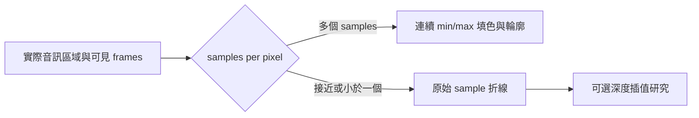

# 波形顯示研究：2026-11-14 / Waveform display research

**狀態：更新前問題分析與本輪採用方案；實作完成，驗證範圍另列。** 本輪在 source commit `5fe9224c3dc54d0a2a655ec6b66522c43bd7a238` 同時實裝「保留安靜片段／Keep quiet sections」與混合 renderer。前者控制往後保留的擷取內容，後者控制既有素材的畫法；兩者各自驗證。本機套件與 Windows 指定 GUI 已有結果，完整 CI／平台限制、新成品 hashes 記於[本輪功能與驗證紀錄](QUIET_CAPTURE_AND_WAVEFORM_2026-11-14.md)，不沿用舊報告作為通過證據。

## 已確認的觀察與判讀

使用者提供的兩張畫面分別是：放大後波形呈點狀；縮遠後呈綠色密集柱狀。第二張已確認是波形本身，不是灰色時間參考線。此處只記錄現象，不把私人圖片或其本機路徑複製進儲存庫。

更新前三平台都以每個 min/max bin 各自畫一根短柱／小矩形，沒有把相鄰 bin 連成連續面。縮遠時的密集柱狀，以及放大時低高度柱的點狀外觀，與這種幾何相符。**這是由程式與畫面現象得到的顯示層判讀，不是已證明音訊有遺失或損壞。**若要判定遺失取樣，仍須比對原始 frame 序列／擷取時鐘與匯出結果，不能只看波形間的留縫。

## 更新前的資料與繪圖幾何

下表記錄這次問題分析時的實作；原始碼連結指向相關檔案，不是凍結舊 renderer 的版本證據。後續混合 renderer 的契約另列於下節。

| 部分 | 已存在的機制 | 與現象的關係 |
| --- | --- | --- |
| 共用核心 | [Capture](../crates/backtracking-core/src/capture.rs) 的 waveform range 將每個 bin 對應到 frame 範圍；frames 少於 bins 時可重複映射同一 frame，範圍仍至少含一個 frame | 單一取樣的 min=max，獨立柱會退化為非常短的標記。這不是為了湊 bins 而留下空 bin |
| Peak cache | [History](../crates/backtracking-core/src/capture/history.rs) 已有每 **128 frames** 的 min/max peak cache，並保留原始取樣 | 已有快取，不能把問題說成「完全沒有 peak cache」；也不需為了連線顯示更換整套框架 |
| 原始素材 | `Snapshot.samples`、`Snapshot::frames` 及既有 snapshot／range 介面 | 近距離 sample polyline 有原始資料基礎，不需要從縮圖猜回取樣 |
| Windows | [paint_waveform](../desktop/windows/src/ui.rs) 對每 bin 畫一條垂直 `line_segment`，同一 view 使用 `policy.waveform_stroke` | Stroke 受顯示政策調整，但不依 bin 水平間距填滿。bins 較少、間距較大時會留縫；不是所有時候都固定為字面上的 1 px |
| VST3／CLAP | [Editor](../plugins/backtracking-plugin/src/editor.rs) 對每 bin 畫獨立矩形；寬度約為 step 的 96%，另受最小 stroke 限制 | 矩形仍各自獨立，可能看到柱間縫隙；低高度時是短矩形而非 sample 間連線 |
| macOS | [WaveformView](../desktop/macos/BacktrackingApp.swift) 每 bin 各自 `move`／`line`，line width 至少為 step 的 75% 或政策 stroke | 同樣沒有相鄰 sample／bin 的連續 path；調粗可以遮住部分縫隙，但沒有改變幾何模式 |

「一個 bin 只含一個 frame 時 min=max」比單用 bins／frames 的不等號更準確。frames 少於 bins 時，原有核心會重複映射 frame，並非製造缺資料的空格；數值不變或真正的零值也可能產生同樣低的 min/max。

## 官方產品與框架的做法

以下只採官方主要來源，查閱日期為 2026-11-14。外部產品的行為是設計參考，並非 Backtracking 已實裝的功能。

| 來源 | 可採用的原則 |
| --- | --- |
| [Audacity Tracks Preferences](https://manual.audacityteam.org/man/tracks_preferences.html) | 個別取樣可見時，可選連接相鄰 sample dots 的線或 stem plot；這種模式區分只在足夠放大後有意義 |
| [Audacity waveform manual](https://www.audacityteam.org/manual/waveform/) | 一般倍率以時間區間的 min/max 表達 peak envelope，足夠放大才畫個別 samples。RMS 可作另一層平均電平顯示，不能和 peak 當成同一條數據 |
| [JUCE AudioThumbnail](https://docs.juce.com/master/classjuce_1_1AudioThumbnail.html) | 背景掃描建立低解析度 waveform cache，資料更新時再要求 repaint；可參考其工作分工，不代表本專案需要改用 JUCE |
| [Steinberg Event Display – Audio](https://www.steinberg.help/r/nuendo/15.0/en/cubase_nuendo/topics/preferences/preferences_event_display_audio_r.html) | 插值曲線針對約一 sample／pixel 或更細的倍率；支持把深度放大模式獨立處理，而非所有倍率都套平滑曲線 |

## 本輪採用的混合 renderer

以實際 audio rect 的寬度 `W` 和可見 frames `F` 決定顯示解析度；所有模式共用相同的原始 frame → x 座標、選區起訖與聲道路由。共用 `waveform_geometry` 產生 `Empty`、`Envelope` 或 `Samples`，平台 renderer 消費幾何後繪製。下列契約由本輪自動化與指定原生操作分別驗證，不能把功能結果視為尚未量測的效能結論。

| 倍率 | 採用的幾何 | 資料來源／限制 |
| --- | --- | --- |
| 遠／中：每個顯示區間涵蓋多個 samples | **連續 filled min/max envelope，加清楚 outline**；每段有限值 run 以 bin 邊界與中心保留 min/max，形成上／下緣 | 沿用既有 peak cache，必要的區間邊界仍讀原始 samples；保持 peak，不用稀疏平均值代替，也不跨無效資料補線 |
| 近：實際 samples 可分辨 | **原始 sample polyline** | 直接連接原始 samples，局部座標為 `x = i / N`，不加 half-bin 位移；不要把重複映射的 bin 當成新增取樣 |
| 更深放大、可選 | 另行評估插值曲線；保留原始 sample markers 作參照 | 先選可解釋的插值策略並驗證邊界。曲線是顯示推算，不能宣稱是新增量測或原取樣間已知的數據 |

自動切換使用實際音訊區域與資料量，不新增 renderer 操作教學或內部技術說明到 UI。操作說明放文件，UI 保持控制與必要狀態。模式邊界、有限值 runs、峰值覆蓋與座標有自動化檢查；繪製成本未作本輪新硬體量測。更深放大的插值及 RMS 內層留作後續研究；不能把現有只存 min/max 的 peak cache 說成已提供 RMS 區間統計，也不承諾本輪插值曲線。

Samples 模式要求資料與原始 frames 一對一，且每對有效的原始 min/max 相同；不是對重複 bin 作平滑重建。合法的 bins 多於 frames 時仍使用 Envelope，不宣稱有額外 samples。輸入 bin 數超過 4096 時回傳 Empty，不截取前段再拉伸成整個範圍。實際 audio width 足以分辨原始 samples 時，顯示政策使用一 frame 一 bin，並有 4096 的解析度上限。

有限振幅只在顯示幾何中裁至 `[-1, 1]`，不改音訊。幾何 helper 收到 NaN／Inf 時會分割 runs，不跨越無效點連線；但既有 extrema／view-peaks 路徑會將全 NaN bin 轉成零，因此這項 helper 契約不是端到端 NaN gap 的保證。

## 本輪整合與驗證項目

1. **統一最小縮放範圍。**更新前 Windows 下限約為 sample rate／100（10 ms）、macOS 約／20（50 ms）、插件約／10（100 ms），進入 sample 模式的能力不同。本輪採共用的實際 occupied width 政策，最深約四個邏輯像素／sample，helper 以 `floor(width / 4)` 為基礎、界於 2–4096 frames，另處理 0／1 frame 與無效寬度。resize 保留原視野；後續 wheel zoom 使用有效上下限，避免因新尺寸而突變目前範圍。Windows 中間建置已觀察 10.00→4.51→0.42→0.04→0.01 秒連續畫法；本輪沒有新增原生 resize 或實體 Shift-drag 驗證，也未做 macOS／DAW GUI 驗收。
2. **保留資料與視野契約。**沿用固定編輯素材、原始取樣位置及 A/B 同一起訖；換畫法不應重切選區、改匯出取樣或暫停背景擷取。
3. **繪圖分工。**沿用 128-frame peak cache 與現有背景準備／快取流程；不同解析度的 envelope／sample window 以來源 generation、frame range、layout 作有效性邊界。UI 不因新幾何而同步等待整段資料。
4. **處理安靜與極端值。**零值形成可辨的零線；DC offset、常數、脈衝、正負峰、超過顯示範圍及非有限值有明確幾何規則。這些由幾何回歸覆蓋，不從使用者兩張圖片推斷音訊原因；helper 的非有限值契約仍受前述 upstream NaN→0 限制。
5. **驗證連續感與成本。**至少檢查不同 DPI／視窗寬度、相同 sample window 的跨平台畫法、模式邊界、pan／zoom 的穩定性及 peak preservation。再以可重現的實裝量測報 CPU／記憶體與繪製時間，不沿用舊硬體數字為新版 renderer 背書。

## 與保留安靜片段的範圍區分

`Keep quiet sections` 決定未來的低音量／零值／已知來源時鐘安靜區間是否進入 history；混合 renderer 決定已保留資料如何繪圖。本輪同時整合兩者，但切換 quiet 選項不是切換 renderer，也不會復活先前已丟棄的音訊。Windows 無封包時的有時鐘 padding、macOS 無 callback 時等待真實 timestamp、來源中斷狀態，都須依擷取規格另驗證，不能用一條平滑波形當成已通過的證據。
